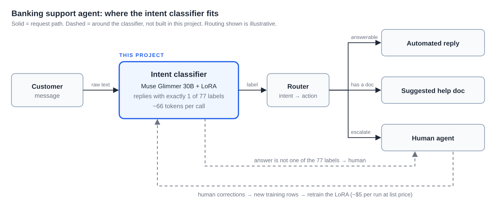
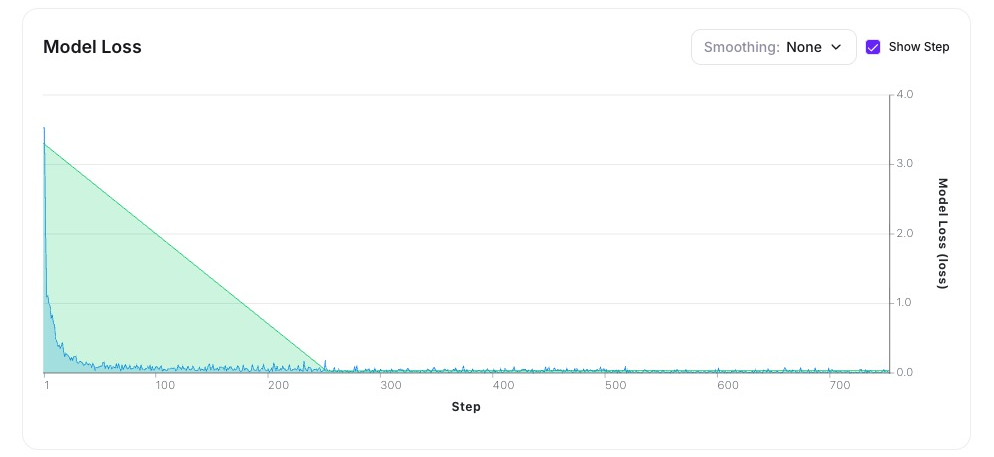
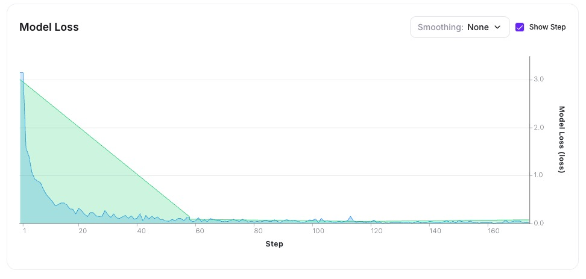
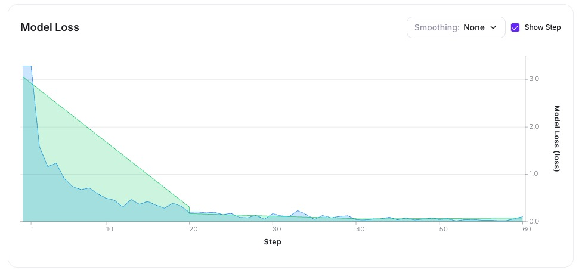

# Fine-Tune, Prompt, or RAG? Classifying 77 Banking Intents with a LoRA

*Griffin Sisk · October 18, 2026*

## Overview

I wanted to know whether a supervised fine-tuned (SFT) LoRA is more accurate and cheaper than calling a base model with a detailed system prompt, or a base model plus RAG. I tested this with a simple use case, labeling a banking customer's message with one of 77 intents.

- **SFT vs. Prompting: SFT.** The LoRA trained on the most data, scoring 92.7%. The base model with a 77-label prompt scored 76.9%.
- **SFT vs. RAG: It's a tie.** When RAG could retrieve from the full training set, it scored 94.0% against the LoRA's 92.7%. On 385 test messages the 95% confidence intervals overlap heavily (about ±3 points), so neither is demonstrably better. The gap is 5 messages out of 385. With equal data, RAG is at least as accurate.
- **Where the LoRA wins: tokens.** It needs about 12× fewer tokens per request (66 vs. about 770). On Fireworks the base model requires at least an \$8/hr dedicated GPU, so the savings show up as lower latency and more headroom per GPU.

## The Use Case

The use case idea is a banking support agent. The first thing it has to do is classify an incoming message into one of 77 predefined intents. That intent then decides what happens next: an automated reply, a suggested help doc, or a handoff to a human.

This post is about the one Intent Classifier component highlighted in the diagram below. The question is whether it should be a fine-tuned LoRA, a prompted base model, or a base model with retrieval.



## The Data

I used [banking77](https://huggingface.co/datasets/mteb/banking77/tree/main) dataset from [MTEB](https://huggingface.co/mteb): 13,083 customer messages across 77 intents, split into 10,003 training and 3,080 testing rows. The intents have between 35 and 187 examples each.

`banking77_train.jsonl` – This is the dataset I passed to Fireworks to fine tune the base model. I used `prepare_banking77.py` to re-format the train.jsonl from HuggingFace into the acceptable Fireworks standard. This data includes:

- A short system prompt
- A potential user question (example)
- A specific intent from the predefined list of 77

```
{"messages": [{"role": "system", "content": "You classify customer support messages for a bank. Reply with exactly one intent label and nothing else."}, {"role": "user", "content": "The balance hasn't changed yet after depositing a cheque with some money."}, {"role": "assistant", "content": "balance_not_updated_after_cheque_or_cash_deposit"}]}

{"messages": [{"role": "system", "content": "You classify customer support messages for a bank. Reply with exactly one intent label and nothing else."}, {"role": "user", "content": "From what countries can I use an account?"}, {"role": "assistant", "content": "country_support"}]}

{"messages": [{"role": "system", "content": "You classify customer support messages for a bank. Reply with exactly one intent label and nothing else."}, {"role": "user", "content": "Currently I can't get my card to work."}, {"role": "assistant", "content": "card_not_working"}]}
```

`banking77_heldout.jsonl` – similar to the training set, but only includes examples outside the training samples. The data includes user queries and the correct associated labels. This allows me to test and score how the trained model answers queries it was not already trained on, instead of just memorizing training data. It holds 385 messages (5 per intent)

```
{"text": "How do I make contactless work", "label": "contactless_not_working"}
{"text": "can you limit my top up?", "label": "top_up_limits"}
{"text": "why isnt top up working", "label": "top_up_failed"}
```

## The Experiment

### The Three LoRAs

**Base model:** Muse Glimmer 30B.

**I trained 3 different LoRAs:** This allowed me to understand what level of training data is needed to achieve a necessary level of accuracy.

Each training job had identical settings (3 epochs, LoRA rank 8, batch size 32, default learning rate). 

Fireworks held out 20% of each training file to report the evaluation loss below, so each LoRA actually trained on 80% of its file:

| **LoRA** | **Rows in file** | **Rows trained (80%)** |
| --- | --- | --- |
| 10 examples per intent | 770 | 616 |
| 30 examples per intent | 2,310 | 1,848 |
| Full dataset (35 - 187 examples per intent, allows common examples to be weighed heavier) | 10,003 | 8,002 |

## Training Results

### Reading the Loss Charts

Loss measures how wrong the model’s predictions are. The lower it goes, the more confidently the model picks the right label. Each chart has two lines.

- blue line = training loss, measured on the rows the model is learning from. 
- green line = evaluation loss, measured once per epoch on the 20% of rows held back, which is why it's drawn as straight segments. 

I want both lines dropping quickly and then flattening out close together. If training loss keeps falling, while evaluation loss plateaus or starts rising, the model is memorizing the training data instead of learning the patterns it can apply to new customer queries.

Low loss doesn’t guarantee the model gets the right answers, though. That’s why I also measure accuracy on the separate test set.

#### All data (8,002 rows trained, 753 steps)



#### 30 per intent (1,848 rows trained, 174 steps)



#### 10 per intent (616 rows trained, 60 steps)



### What the Charts Show

With only 77 short labels to learn, the model picked up both the labels and the bare-label output style almost immediately.

Evaluation loss seemed to stabilize at ~0.032 after the first epoch. The difference between Training Loss and Evaluation loss is a signal for overfitting (a model that memorizes training data as opposed to the underlying pattern). 

The ratio here is small, even after the first epoch, meaning it did its job and the next 2 epochs didn’t provide too much else. This was to be expected with a little amount of data. 

## The Baselines

In order to test the performance of the LoRAs I needed to set a baseline. To do this, I tested the base model 3 different ways with the below:

- **Long prompt:** the one-line system prompt plus all 77 labels. (Shown below)
- **RAG, 2,310-row dataset:** the long prompt plus the 10 most similar labeled examples from the 2,310 rows, retrieved with TF-IDF.
- **RAG, full training set:** the same, retrieving from all 10,003 training rows. This is the data-matched comparison for the all-data LoRA.

#### System Prompt + Labels

```
You classify customer support messages for a bank. Reply with exactly one label from this list and nothing else: Refund_not_showing_up, activate_my_card, age_limit, apple_pay_or_google_pay, atm_support, automatic_top_up, balance_not_updated_after_bank_transfer… (continued)
```

## Scoring

#### Deployments

For inference testing I deployed 4 different GPUs (BF16 NVIDIA H200 141GB – about \$8/hour)

Each GPU hosted a different LoRA and the last GPU hosted the base model for system prompt testing and RAG testing. 

#### score.py and Sample Output

`score.py` — sends each message at temperature 0 and grades by exact string match. There is no partial credit, and an answer that isn't one of the 77 labels counts as wrong. The LoRAs were called with the same system prompt they trained on.

The scoring run returned the results that I captured for analysis that looked like this:

```
% python score.py "$M/banking77-glimmer-30b-v1#$D" --prompt short --reasoning-effort high

model:   accounts/<your-account>/models/banking77-glimmer-30b-v1#accounts/<your-account>/deployments/<deployment-id>
prompt:  short
rows:    385  (26s)
accuracy: 330/385 = 85.7%
answers that were not exactly one of the 77 labels: 5
tokens:   22,460 prompt + 3,166 completion  (~58 prompt tokens per call)
most common misses (expected -> got):
  4x  card_swallowed -> 'declined_cash_withdrawal'
  4x  failed_transfer -> 'beneficiary_not_allowed'
  3x  transfer_timing -> 'transfer_not_received_by_recipient'
…
```

## Results

All scores are on the same 385 held-out messages.

| **Approach** | **Accuracy** | **95% CI** | **Tokens / request (in + out)** |
| --- | --- | --- | --- |
| 10-per-intent LoRA | 77.9% (300/385) | 73.5–81.8% | 66 (58 + 8) |
| 30-per-intent LoRA | 85.7% (330/385) | 81.9–88.9% | 66 (58 + 8) |
| All-data LoRA | **92.7% (357/385)** | 89.7–94.9% | 66 (58 + 8) |
| Base + long prompt (77 labels) | 76.9% (296/385) | 72.4–80.8% | 551 (448 + 103) |
| Base + RAG, 2,310-row pool | 90.4% (348/385) | 87.0–92.9% | 783 (686 + 97) |
| Base + RAG, full training set | **94.0% (362/385)** | 91.2–96.0% | ~770 (~683 + ~86) |

#### What Stands Out

1. **Fine-tuning beats a long prompt, and cheaply.** The 10-per-intent LoRA matches the long prompt (77.9% vs. 76.9%) while using about 8× fewer tokens per request. The all-data LoRA is 15.8 points ahead.
2. **More data kept helping, for both methods.** The LoRAs rose from 77.9% to 85.7% to 92.7% as training rows grew from 616 to 1,848 to 8,002. RAG rose from 90.4% to 94.0% when its pool grew from 2,310 to 10,003 rows.
3. **With equal data, RAG is at least as accurate.** On the 2,310-row data, RAG beat the LoRA by 4.7 points. On the full data RAG beat LoRA 94.0% vs. 92.7%. *RAG also had a small data advantage as it retrieved from every row, while each LoRA trained on 80% of its file. I couldn’t match this as Fireworks randomly hid 20% during training for eval loss.* 
4. **RAG's ceiling is high.** With the full pool, the right label appeared among the 10 retrieved examples for **96.1%** of test messages. Picking the most common label among those examples, **with no model at all, scored 82.8%** (not charted)
5. **Most misses are neighboring intents.** Every method confuses the same pairs: `card_arrival` vs. `card_delivery_estimate`, `top_up_reverted` vs. `top_up_failed`, `declined_transfer` vs. `declined_card_payment`. These overlap in meaning, so even a perfect model would not reach 100% on Banking77. I could consider merging or redefining the confusable labels.

## Cost

The results showed a pretty close accuracy comparison between the base model + RAG options and my full data fine-tuned LoRA. Since both options have similar accuracy, choosing between the two comes down to the cost and maintenance of inference and training.

### Training Cost

Fireworks charges \$3.00 per 1M training tokens for LoRA SFT on models between 16.1B and 80B parameters. For Muse Glimmer 30B, SFT through the UI is free until November 30, 2026, so I paid nothing for these jobs.

| **LoRA** | **Rows trained** | **Training tokens** | **Training Cost (list price)** |
| --- | --- | --- | --- |
| 10 per intent | 616 | ~124K | ~\$0.37 |
| 30 per intent | 1,848 | ~371K | ~\$1.11 |
| All data | 8,002 | ~1.61M | ~\$4.83 |

Training Cost = dataset rows trained \* average tokens per row of training data \* epochs \* model cost per 1M training tokens/1,000,000

Full LoRA Fine-Tuned → 8,002 \* 67 \* 3 \* (\$3/1,000,000) = \$4.83

### Hosting Options

Fireworks doesn’t allow a fine-tuned LoRA to run on serverless, so hosting requires a dedicated GPU. The Muse Glimmer 30B base model is also not supported running serverless.

At the same hourly price, the LoRA's advantage is the 12× smaller request:

- **Lower latency.** Each call sends 58 tokens and gets 8 back, instead of about 683 in and 86 out.
- **More headroom per GPU.** Less work per request means one GPU absorbs more traffic before you need a second. I didn't load-test it, but my target volume (20M requests/month is about 8 requests per second) is likely well within one H200 either way.

That gives two honest scenarios:

- **Both on the same dedicated GPU.** RAG costs the same \$8/hr as the LoRA, so the LoRA wins: similar accuracy, 12× fewer tokens per request (lower latency and more headroom per GPU.)
- **RAG on a serverless model billed per token.** Then the comparison depends on traffic. Assuming a different serverless model could achieve the same accuracy.

### Cost at Different Volumes

If you can serve the base model per token somewhere, RAG's cost scales with traffic while the LoRA's GPU is flat. Assuming roughly \$0.35 per 1M input and \$1.50 per 1M output tokens, RAG with the full pool costs about \$369 per 1M requests.

Based on steady traffic and an always-on GPU (730 hours/month):

| **Monthly volume** | **Base + RAG (serverless)** | **Full LoRA (dedicated GPU)** |
| --- | --- | --- |
| 1M calls (~1,370/hr) | ~\$369/mo (~\$0.51/hr) | ~\$5,840/mo (~\$8.00/hr) |
| 15M calls (~20,550/hr) | ~\$5,533/mo (~\$7.58/hr) | ~\$5,840/mo (~\$8.00/hr) |
| 20M calls (~27,400/hr) | ~\$7,377/mo (~\$10.11/hr) | ~\$5,840/mo (~\$8.00/hr) |

The break-even is about **15.8M calls/month**. Below that, RAG is cheaper. At 20M the LoRA saves about **\$1,540/mo (21%)**, and the gap keeps growing, because the GPU price is flat until the GPU saturates.

### What This Leaves Out

- **Scale-to-zero.** Fireworks scales a deployment to zero after an hour without traffic, which changes low-traffic math, but a cold start returns a 503 while it wakes (`score.py` retries for this). I priced the always-on case.
- **Maintenance.** A new intent means adding rows to a RAG index, but a LoRA retrain. At about \$5 a run the retrain itself is cheap; the real cost is the data pipeline and re-evaluation.
- **Prices change.** Everything here reflects Fireworks' pricing and docs as of mid-October 2026: [pricing](https://fireworks.ai/pricing), [on-demand deployments](https://docs.fireworks.ai/guides/ondemand-deployments), [deploying LoRAs](https://docs.fireworks.ai/fine-tuning/deploying-loras).

### Does a Smaller Base Model Help?

I also trained LoRAs on Qwen 3.5 9B and Qwen 3 4B on all 10,003 rows, expecting a cheaper model at similar accuracy. Fireworks' deploy screen projected the same \$8/hour for the 4B as for the 30B, because a dedicated deployment is priced by GPU, not by parameter count. A smaller model would only cut cost if traffic needed more GPUs than the 30B, which it doesn't at this volume. So I didn't score them. 

## Takeaways

- **Does SFT beat prompting?** Yes, by a wide margin. Even the smallest LoRA matches a 77-label prompt while sending far fewer tokens.
- **Does it beat RAG?** No. With access to the same data, RAG scored 94.0% to the LoRA's 92.7%, inside the noise. If your intents change often, RAG is the safer default, since adding an intent means adding rows, not retraining.
- **When does the LoRA win?** When latency or per-GPU throughput matters, since it does the same job with 12× fewer tokens on the same \$8/hour GPU, or at high volume against a per-token host (roughly 16M+ requests a month). Or if you’re able to find a serverless provider that accepts custom LoRAs. 

## What I'd Test Next

1. **An embedding retriever** instead of TF-IDF for RAG.
2. **One epoch instead of three,** since the loss charts suggest the later epochs add little.
3. **Fairer baselines:** cap output tokens or use structured output on the prompt and RAG runs, and sweep reasoning effort.
4. **A plain fine-tuned BERT-style classifier.** A 77-way classifier may not need a generative model at all.
5. **A load test** on the dedicated GPU, to measure how many requests per second each approach really handles.
6. **Try a more classification-specific model** like [Jev](https://typesafe.ai) to test for higher accuracy at less cost. 
